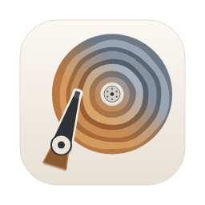
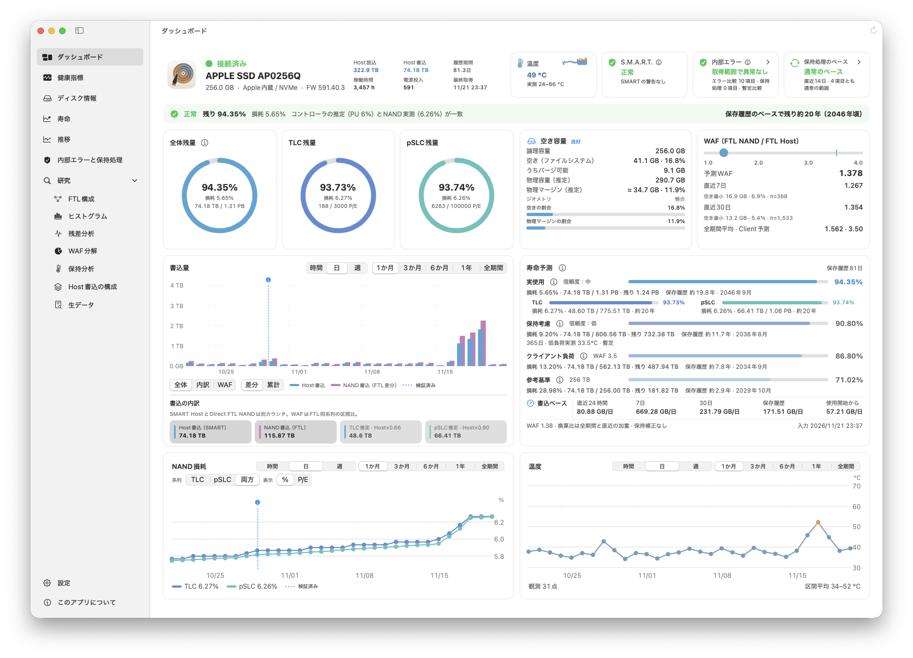
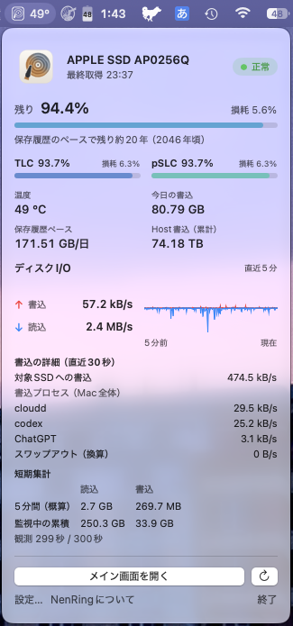

**日本語** · [English](README.md)

<h1>
  <picture>
    <source media="(prefers-color-scheme: dark)" srcset="Resources/NenRingIcons/AppIcon-dark.iconset/icon_128x128@2x.png">
    <source media="(prefers-color-scheme: light)" srcset="Resources/NenRingIcons/AppIcon-light.iconset/icon_128x128@2x.png">
    
  </picture>
  NenRing
</h1>

<sub>Mac内蔵SSDの損耗を記録し、寿命を予測します。</sub>

<picture>
  <source media="(prefers-color-scheme: dark)" srcset="docs/images/dashboard-ja-dark.png">
  <source media="(prefers-color-scheme: light)" srcset="docs/images/dashboard-ja-light.png">
  
</picture>

NenRingはMac内蔵SSDの詳細情報を取得し、監視・記録をもとにSSDの状態や寿命予測等を表示するmacOS向けアプリです。

SMART（S.M.A.R.T.、Self-Monitoring, Analysis and Reporting Technology。NVMeでは「SMART / Health Information」ログ）、AppleのFTL（Flash Translation Layer、フラッシュ変換層）の統計、温度、書き込み履歴を取得し、データはすべてローカルに保存します。

取得できた情報から、SMARTの警告や、不良ブロック・訂正不能エラーなどの増加を画面に表示します。FTLの項目を暫定的に解釈して比較する場合は、「暫定比較」と表示します。

> [!NOTE]
> 開発中のため予測の計算や表示は今後変更されることがあります。予測は研究上の推定で、Appleの公称値・保証・故障予測ではありません。他の機種やmacOSでも動作するよう設計していますが、実機で取得と予測を確認したのはM1 MacBook Air 1台のみです。

[動作を報告する（添付不要）](https://github.com/mugisk/NenRing/issues/new?template=compatibility-report.yml) · [診断レポートを提供する](https://github.com/mugisk/NenRing/issues/new?template=diagnostic-report.yml)

どちらの報告にもGitHubアカウントが必要です。投稿者のユーザー名、報告内容、添付ファイルは公開されます。

[インストール](#インストール) · [機能](#機能) · [対象ストレージ](#対象ストレージ) · [プライバシーとデータ](#プライバシーとデータ) · [ドキュメント](docs/README.md) · [他環境のデータ提供](#他環境のデータ提供診断レポート)

### メニューバー

<picture>
  <source media="(prefers-color-scheme: dark)" srcset="docs/images/menubar-ja-dark.png">
  <source media="(prefers-color-scheme: light)" srcset="docs/images/menubar-ja-light.png">
  
</picture>

## 必要環境

- 実行にはmacOS 14以降のApple Silicon Macが必要です。外付けNVMeでは `smartctl` で取得できる範囲で動作します。
- SMARTの取得に [smartmontools](https://www.smartmontools.org/) を使用します。インストール方法は[次の節](#smartmontoolsの導入)を参照してください。
- ビルドにはXcode 26以降が必要です。Xcode 26の動作にはmacOS 15.6以降（Xcode 26.4.1以降はmacOS 26.2以降）が必要なため、macOS 14ではビルドできません。最後にビルドを確認したバージョンはXcode 27.0です。

## smartmontoolsの導入

NenRingはSSDの状態（SMART）と温度をsmartmontoolsに含まれる `smartctl` で取得します。インストールは初回のみ必要です。未導入のままNenRingを開くと、画面にも同じ手順が表示されます。

1. ターミナルを開き、次のコマンドを貼り付けてreturnキーを押します。

   ```sh
   brew install smartmontools
   ```

   `brew` が見つからないと表示された場合は、先に [Homebrew](https://brew.sh) をインストールしてください。Homebrewを使用しない場合は、[smartmontoolsの公式ページ](https://www.smartmontools.org/wiki/Download)からmacOS用のインストーラ（.dmg）を使用することもできます。
2. 次のコマンドでバージョンが表示されれば、導入は完了です。

   ```sh
   smartctl --version
   ```

3. NenRingに戻ります。アプリに戻ると自動で再検索します。見つからない場合は「再試行」を押してください。

アプリは `PATH` と、`/opt/homebrew`、`/usr/local`、`/opt/local`（MacPorts）の `bin`・`sbin` から `smartctl` を探します。アプリには同梱せず、外部のプログラムとして呼び出します。`smartctl` がなくてもアプリは起動しますが、SMARTと温度は表示されません。取得できる項目はMac、macOSのバージョン、デバイスによって異なり、アプリは `smartctl` が返した値のみを表示します。

## インストール

### 配布版

NenRingの配布版はGitHub ReleasesからDMG形式で提供します。配布版はアドホック署名のみで、Appleによる公証を受けていません。そのため、初回起動時にmacOSでの許可の操作が必要です。

1. **ダウンロード**：[Releasesのページ](https://github.com/mugisk/NenRing/releases)から、`NenRing-<バージョン>-<revision>.dmg` と、同名の `.sha256` ファイルをダウンロードします。
2. **チェックサムの確認**：ターミナルで次のコマンドを実行します。ファイル名はダウンロードしたものに置き換えてください。

   ```sh
   cd ~/Downloads
   shasum -a 256 -c NenRing-<バージョン>-<revision>.dmg.sha256
   ```

   「OK」と表示されれば、ダウンロードしたファイルは配布したものと一致しています。「FAILED」と表示された場合は使用せず、ファイルを削除してください。
3. **アプリのコピー**：DMGを開き、NenRing.appを同じウインドウ内の「Applications」へドラッグします。DMG内のアプリは直接起動せず、コピーしたアプリを起動してください。
4. **初回起動の許可**：コピーしたNenRing.appを開くと、Appleが検証できないアプリとして起動が停止されます。この警告には起動を続ける選択肢がありません。警告を閉じた後、「システム設定」→「プライバシーとセキュリティ」を開き、NenRingの「このまま開く」を選択すると起動します。このとき管理者の認証が求められます。詳細はAppleのサポート記事「[Macでアプリを安全に開く](https://support.apple.com/ja-jp/102445)」を参照してください。
5. **smartmontoolsの導入**：未導入の場合は、[smartmontoolsの導入](#smartmontoolsの導入)の手順に従ってください。

以前のバージョンから更新する場合は、NenRingを完全に終了（⌥⌘Q）してから、手順3で既存のアプリを置き換えます。記録済みの履歴と設定はアプリとは別の場所に保存されているため、そのまま引き継がれます。

破損やマルウェアの検出を示す警告が表示された場合は、起動を中止し、ダウンロード元とチェックサムを確認してください。Gatekeeper全体を無効にする操作は不要であり、推奨しません。組織が管理するMacや、管理者でないユーザーアカウントでは、許可できない場合があります。

アプリの起動の許可と、SSDの詳細統計を取得する権限は別のものです。管理者権限でのprobeの実行条件は[署名検証](docs/PROBE_SIGNATURE.md)を参照してください。

### ソースからのビルド

```sh
git clone https://github.com/mugisk/NenRing.git
cd NenRing
./scripts/swiftpm.sh test
./scripts/build-app.sh
open build/NenRing.app
```

アプリは `build/NenRing.app` に生成され、アドホック署名されます。そのまま起動しても、`/Applications` にコピーしてもかまいません。独自の証明書で署名する場合は `CODE_SIGN_IDENTITY` を指定してください。SwiftPMの再利用できる成果物は `build/swiftpm/` と `build/swiftpm-cache/` に残します。このリポジトリにはDeveloper ID署名と公証の手順は含まれていません。

## 機能

- **ドライブの状態**：SSDの識別情報、SMARTの状態、温度、稼働時間、電源投入回数、容量と空き容量。
- **書込履歴と読込総量**：HostとNANDの書込量を時間・日・週単位で表示します。Direct FTLを取得できる場合は、TLC／pSLCの推定書込量へ切り替えられます。Host Readsは累積値で表示します。
- **リアルタイムI/O**：監視中はメニューバーのポップアップで読込・書込速度と直近5分のグラフを確認できます。詳しくは[普段の操作](#普段の操作)を参照してください。
- **損耗と寿命の予測**：TLCとpSLCの損耗ゲージと、残り書込量・到達時期を比べる4つの予測を表示します。
- **内部エラーと保持処理**：ダッシュボードの情報ボタンから、異常counterの増分（内部エラー）と、refreshやread verifyなどのデータ保持の処理（保持処理）を別々に確認できます。保持処理のみで故障とは判定しません。保持処理のペースは直近14日と最大8週間の基準を比較し、ダッシュボード上部のカードに表示します。設定の「簡易チェック」を有効にすると、新しく検出した警告やペースの上昇を通知します（既定はオフ）。確認済みのscalar異常counterは、対応表・取得形式とコア履歴の連続性が成立すれば他のmacOS buildでも暫定比較します。暫定解釈であることを表示し、counter逆行などの不整合は比較を保留します。histogramやrefreshの研究指標は実行buildの確認条件を維持します。[表示の範囲と限界](docs/DASHBOARD_RELIABILITY_INDICATORS.md)。
- **研究用の画面**：FTL topology、WAF、保持の研究モデル、信頼性イベント、取得値とその取得元。
- **取得できない値**：「未取得」と表示し、0や「正常」に置き換えません。未知の旧診断形式や外部ツールの出力は原文を保持します。
- **日本語・英語**：画面は日本語と英語に対応します。
- **診断レポートの書き出し**：他のMacへの対応拡大に使用します。[他環境のデータ提供](#他環境のデータ提供診断レポート)を参照してください。

<details>
<summary>4つの予測について</summary>

- **実使用**：TLCとpSLCのどちらかが先に目標P/Eに達するまでの残りHost書込量です。観測履歴から推定した書込増幅（WAF）で換算します。Direct FTLを取得できる場合は、TLCとpSLCそれぞれの横棒もNAND書込量で表示します。この基準シナリオには保持補正をかけません。ダッシュボード上部とメニューバーの損耗は、実使用の値（累積Host ÷ 予測総Host）です。予測WAFの変化により、書込が増えても値が下がる場合があります。詳しくは[予測の見方](docs/FORECAST_GUIDE.md)を参照してください。
- **保持考慮**：低負荷時の実測温度を保管温度と仮定し、通常365日としてTLCに保持補正を適用する別の比較です。指定温度と観測不足時の既定30°Cは区別して示します。電源OFF中の温度は測定しておらず、Apple SSDの保持性能を確認した値でもありません。
- **クライアント負荷**：将来のWAFを3.5（比較範囲3〜4）と仮定した予測です。この値は研究用の負荷仮定で、JEDECの規定値ではありません。
- **参考基準**：NANDの情報と論理容量から求める比較値です。情報ボタンの説明で採用元、世代対応が未確認かどうか、NAND未特定時の既定値（600 TBW/TB）を確認できます。

</details>

## 対象ストレージ

NenRingはApple Silicon Macの内蔵Apple SSDを主な対象にしています。SMARTの候補が複数見つかった場合は、macOSが内蔵と判定したものを優先します。外付けのSSDやNVMeでも、`smartctl` で取得できればSMARTの値を表示できますが、Direct FTLの値は結び付けません。FTLの値、NANDの構成、TLC／pSLCのP/Eを結び付けるのは、選択中のデバイスがApple内蔵ストレージだと確認できた場合のみです。

## Direct FTL（Appleの非公開インターフェース）

NenRingはSMARTのほかに、SSD内部のFTLの統計を取得します（Direct FTL）。SMARTの表示はDirect FTLがなくても動作し、FTLの自動取得は既定でオンです。設定でFTLの自動取得のみをオフにできます。

取得には、アプリに同梱した2つの小さなプログラム（probe）である `asp-ftl-stats-probe` と `asp-snapshot-probe` を使用します。どちらも `scripts/*.c` からビルドします。読み取り用として調査した固定の呼び出しのみを使用し、コントローラへの書き込みや設定変更を行う機能はありません。非公開のインターフェースであるため、内部の動作までは確認できません。probeが開くのはAppleの内蔵SSDコントローラのみで、Thunderbolt接続などの他社製NVMeには非公開の呼び出しを送りません。

ただし、この取得には**Appleが公開していない非公開インターフェース**を使用します。Appleはこのインターフェースをサポートしておらず、macOSの更新により変更されたり、利用できなくなったりすることがあります。

<details>
<summary>取得する条件と、取得値ごとの確認</summary>

- **対象**：macOS 14・15・26・27で、内蔵Apple SSDを持つApple Silicon Macです。データ形式とkeyの対応表を確認したのは、M1 MacBook Air 1台でのmacOS 26・27です。14・15は互換性を想定した試行です。その他のmacOSでは設定から手動で1回取得し、次の確認を通過すれば、このMacのそのバージョンのmacOSで定期取得を開始します。
- **取得値ごとの確認**：同じディスクの24時間以内のSMARTと、Host書込量が1%または5 GBの大きい方の範囲で一致すること、NAND書込量の単位が妥当なこと、FTLとSMARTの稼働時間の差が急激に変化しないことを確認します。確認で不一致となった取得は保存せず、自動取得を停止します。照合用のSMARTがない場合は保存を保留し、それのみでは定期取得を停止しません。詳しくは[データ取得の仕組み](docs/DATA_ACQUISITION.md)と[照合の仕様](docs/DIRECT_FTL_CROSS_VALIDATION.md)にあります。
- **取得の間隔**：SMARTと同じ周期で取得します。既定は10分ごとで、設定で5分〜1時間の範囲で変更できます。FTLの自動取得のみをオフにすることもできます。定期取得は3回連続で失敗すると停止します。自動で管理者認証を求めたり、sysdiagnoseを起動したりはしません。
- **管理者認証**：手動のFTL取得が権限不足で拒否された場合に限り、macOS標準の画面で管理者認証を求めて再試行することがあります。この再試行は、probeから `/` までのすべてのフォルダがroot所有で、グループやその他から書き込めない場合のみ行います。そのため、標準の `/Applications` に置いたアプリでは行いません。パスワードは保存せず、日常の監視には必要ありません。
- **確認の限界**：上記の確認で検出できるのは、単位の違いや値の急な変化です。それぞれの非公開の値の意味まで保証するものではありません。特にmacOS 14・15と、比較できる過去の記録がない導入直後は注意してください。現在の確認内容は[Direct FTLの照合仕様](docs/DIRECT_FTL_CROSS_VALIDATION.md)にまとめています。

</details>

セキュリティの考え方と報告方法は [SECURITY.ja.md](SECURITY.ja.md) を参照してください。

## プライバシーとデータ

- **権限**：アプリは通常のユーザー権限で動作します。管理者認証を求めるのは、手動のFTL取得の再試行のみです（上記）。
- **履歴**：SMART、温度、FTL、研究の履歴と使用設定は、`~/Library/Application Support/NenRing/` に保存します。標準保存ではSMART・温度・FTLの観測点を間引かず、可逆圧縮して保持します。バックアップには `.lossless/` を含む保存先全体をコピーしてください。以前の保存形式の保管庫も保持します。詳しくは[計測履歴の保存方式](docs/LOSSLESS_HISTORY_STORAGE.md)を参照してください。
- **アプリの環境設定**：`io.github.mugisk.NenRing` のdefaultsに保存します。
- **`asptool` のログ（任意）**：NenRingがAppleの `asptool` やsysdiagnoseを実行することはありません。`asptool_snapshot.log`（sysdiagnoseに含まれます）を **設定 → 研究** から読み込むと、近い時刻のDirect FTLと値を比較し、基準内で一致したかを判定します。sysdiagnoseの `.tar.gz` もそのまま選択できます。「ターミナルで実行…」を押すと、ターミナルで `sudo sysdiagnose` を開始し、完了後に自動で読み込みます。パスワードの入力はターミナルで行います。数値が一致し、同じsysdiagnoseに含まれるmacOSとSSDファームウェアもDirect FTLと一致した環境は、macOSのメジャーバージョンとファームウェアの系列ごとに、このMacで確認済みの環境として記録します。読み込んだログと記録は寿命予測には使用しません。
- **通信なし**：アプリ自体は通信を行わず、測定値やシリアル番号等をユーザーの許可なく送信しません。

## 普段の操作

言語は「設定 → 一般」で選択すると、すぐに画面へ反映されます。「システムに合わせる」では、日本語環境では日本語、それ以外では英語になります。言語を変更しても、記録済みデータや予測計算は変更されません。

現在の読み書きは、バックグラウンド監視中に対象ディスクが選択されていればメニューバーのポップアップで確認できます。OSのカウンタを取得するのみのため、SMART・FTLの取得頻度は増やしません。設定の「メニューバーにI/O速度を表示」はアイコン横の文字列のみを切り替え（初期状態は非表示）、取得の有効・無効は切り替えません。グラフの中央線より上の赤が書込、下の青が読込で、共通の速度スケールです。各点は取得間隔（既定2秒）の平均速度なので、どちらにも短いピークが出ることがあります。グラフの下の「短期集計」に観測した累積量を表示します。短期集計はメモリ内のみに保持します。SMARTの生涯累積やFTLのNAND書込量とは別の統計で、寿命予測には使用しません。詳しくは[データ取得の仕組み](docs/DATA_ACQUISITION.md#リアルタイムio)を参照してください。

⌘Qはウィンドウを閉じるのみで、メニューバーでの監視は続きます。完全に終了するには⌥⌘Qを押すか、メニューバーの「終了」を選択してください。

<details>
<summary>アンインストールと、履歴・設定の削除</summary>

アンインストールするにはNenRingを完全に終了してアプリを削除します。履歴と設定も削除する場合のみ、必要なバックアップを取ってから次のコマンドを実行してください。削除した履歴はアプリから復元できません。

```sh
rm -rf ~/Library/Application\ Support/NenRing
defaults delete io.github.mugisk.NenRing
```

</details>

## 他環境のデータ提供（診断レポート）

取得・解析・予測計算の動作を確認した実機は、256 GBのMacBook Air（M1、Hynix TLC）1台です。予測した寿命や保持性能を実証したものではありません。他のMac・容量・macOS buildのレポートが、取得可能な環境を確認する材料になります。Direct FTLの値がないレポートも有用です。

[動作報告](https://github.com/mugisk/NenRing/issues/new?template=compatibility-report.yml)には、Macの機種、macOSのバージョン、動作を確認した機能や取得できなかった項目を記入してください。診断ファイルも提供いただける場合は、以下の手順で保存できます。

1. 設定の「一般」→「アプリ」→「診断レポート」にある「提供する…」を押します。
2. 開いた画面で「保存…」を押し、ファイルを保存します。
3. 「GitHubでIssueを開く」を押します。開いたページの「Diagnostic report」の欄へ保存したファイルをドラッグし、必須の共有確認（Sharing review）にチェックを入れて投稿します。投稿にはGitHubのアカウントが必要です。

> **共有される内容**
>
> - 含むもの：Macの機種ID・チップ・macOSのbuild、アプリのバージョン、SSDのモデル・firmware・容量とSMARTの要約（稼働時間、書込量、温度を含む）、NANDの構成、FTLの要約。日付は日単位に丸めます。
> - 含まないもの：シリアル番号、デバイスパス、デバイスID。
> - Issueと添付ファイルは誰でも閲覧できます。共有したくない値は投稿前にファイルから削除してください。アプリから自動で送信することはありません。

項目の詳細と、届いたレポートの確認方法は[診断レポートの手順と確認範囲](docs/DIAGNOSTIC_REPORTS.md)にあります。

## 開発への参加

不具合の報告、診断レポート、プルリクエストを歓迎します。ビルド、ローカルでの確認、変更の提出方法は [CONTRIBUTING.ja.md](CONTRIBUTING.ja.md) を参照してください。

## ドキュメント

[寿命予測の読み方](docs/FORECAST_GUIDE.md)と[ドキュメントの目次](docs/README.md)から参照できます。目次と、予測・取得・照合・レポート・保存・probeの安全性・ローカルCIを扱う7文書は日英で用意しています。詳しい研究仕様は当面日本語のみで、目次で区別しています。

- [データ取得の仕組み](docs/DATA_ACQUISITION.md)：SMART・IORegistry・Direct FTLを何からどう読んでいるか。ターミナルで確認するためのコマンド付き。
- [NAND Model v2.4.1](docs/NAND_MODEL_V2_4.md)：現行の寿命予測の計算と、Direct FTLの取得条件。
- [参考TBWとワークロードの前提](docs/REFERENCE_TBW.md)：ダッシュボードの比較基準、FTL不足時の暫定推定と出典。
- [Apple Silicon内蔵SSDのハードウェア](docs/APPLE_SSD_HARDWARE.md)：公開情報から判明している機種別のコントローラとNAND、レポートで補いたい項目。

## 名前とアイコンの由来

日本語の年輪（nenrin）と英語のtree ringに由来します。輪（rin）とringは意味が同じで、響きも綴りも似ています。その偶然の面白さからNenRingと綴りました。
木を切らずに年輪を読み取るように、ディスクの記録から変化を解析します。

アイコンはHDDのプラッタを年輪に見立てたものです。SSDを監視するアプリですが、記憶装置を象徴するモチーフとしてHDDを選びました。色の変化には、木が長い年月をかけて珪化木へと変化する様子も重ねています。

## 免責

本プロジェクトはApple Inc.とは無関係です。Appleの承認やサポートも一切受けておりません。ご利用は自己責任でお願いいたします。本ソフトウェアは無保証で提供されます（[LICENSE](LICENSE) を参照）。

## ライセンス

ソースコードとドキュメントは [MITライセンス](LICENSE) です。NenRingのアイコンとロゴ（`Resources/NenRingIcons/` の画像）にはMITライセンスは適用されず、権利を保持しています（[アイコンとロゴの表記](Resources/NenRingIcons/LICENSE.md) を参照）。NenRingをもとにした改変版やプロジェクトを配布する場合は、NenRingをもとにしていることを記載してください。改変版を配布する際にNenRingの名前を使用する場合は、公式版ではないことを明示してください。smartmontoolsと商標の表記は [THIRD_PARTY_NOTICES.ja.md](THIRD_PARTY_NOTICES.ja.md) を参照してください。
