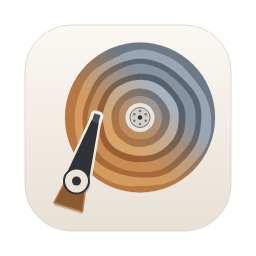
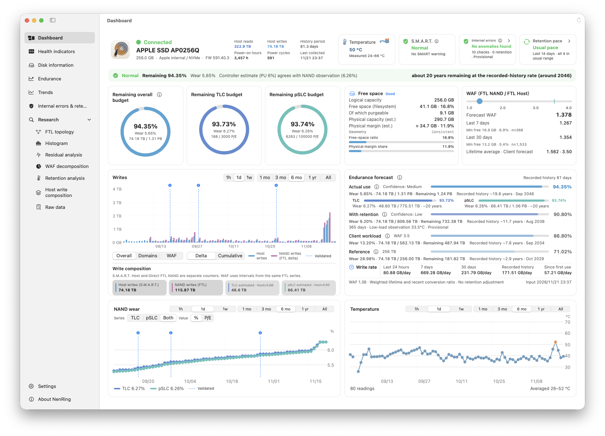
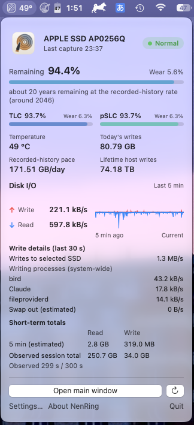

**English** · [日本語](README.ja.md)

<h1>
  <picture>
    <source media="(prefers-color-scheme: dark)" srcset="Resources/NenRingIcons/AppIcon-dark.iconset/icon_128x128@2x.png">
    <source media="(prefers-color-scheme: light)" srcset="Resources/NenRingIcons/AppIcon-light.iconset/icon_128x128@2x.png">
    
  </picture>
  NenRing
</h1>

<sub>Tracks wear on your Mac’s internal SSD and forecasts its lifespan.</sub>

<picture>
  <source media="(prefers-color-scheme: dark)" srcset="docs/images/dashboard-en-dark.png">
  <source media="(prefers-color-scheme: light)" srcset="docs/images/dashboard-en-light.png">
  
</picture>

NenRing is a macOS app that collects detailed information from a Mac’s internal SSD, monitors and records it, and displays SSD status, lifespan estimates and related information.

It reads SMART data (Self-Monitoring, Analysis and Reporting Technology, also written S.M.A.R.T.; NVMe calls it the "SMART / Health Information" log), Apple FTL (Flash Translation Layer) statistics, temperature and write history, and stores all data locally.

Using available readings, it displays SMART warnings and increases in bad blocks, uncorrectable errors and other error counters. FTL comparisons based on provisional interpretation are labeled “Provisional.”

> [!NOTE]
> NenRing is under active development, so its forecast calculations and displays may change. Forecasts are research estimates, not Apple ratings, warranties or failure predictions. It is built to work on other models and macOS releases, but acquisition and forecasts have been checked on real hardware only with one M1 MacBook Air.

[Report how NenRing works on your Mac](https://github.com/mugisk/NenRing/issues/new?template=compatibility-report.yml) · [Share a diagnostic report](https://github.com/mugisk/NenRing/issues/new?template=diagnostic-report.yml)

Both forms require a GitHub account. Your username, report and attachments will be public.

[Install](#install) · [Features](#features) · [Supported storage](#supported-storage) · [Privacy and data](#privacy-and-data) · [Documentation](docs/README.en.md) · [Report your Mac](#contributing-hardware-data)

### Menu bar

<picture>
  <source media="(prefers-color-scheme: dark)" srcset="docs/images/menubar-en-dark.png">
  <source media="(prefers-color-scheme: light)" srcset="docs/images/menubar-en-light.png">
  
</picture>

## Requirements

- To run: an Apple Silicon Mac with macOS 14 or later. External NVMe drives work as far as `smartctl` can read them.
- [smartmontools](https://www.smartmontools.org/) for reading SMART data. See [the next section](#installing-smartmontools) for installation.
- To build: Xcode 26 or later, which needs macOS 15.6 or later (Xcode 26.4.1 and later need macOS 26.2 or later). NenRing can't be built on macOS 14. The build was last confirmed with Xcode 27.0.

## Installing smartmontools

NenRing reads the SSD health (S.M.A.R.T.) and temperature with `smartctl`, which comes with smartmontools. You install it once. If you open NenRing without it, the app shows the same steps.

1. Open Terminal, paste the following command and press Return.

   ```sh
   brew install smartmontools
   ```

   If Terminal says `brew` is not found, install [Homebrew](https://brew.sh) first. Without Homebrew, you can instead install the macOS installer (.dmg) from the [smartmontools download page](https://www.smartmontools.org/wiki/Download).
2. Check that it worked: the following command should print a version.

   ```sh
   smartctl --version
   ```

3. Go back to NenRing. It looks again when you return to the app; if it still does not find `smartctl`, click Retry.

The app looks for `smartctl` on `PATH` and in the `bin` and `sbin` folders of `/opt/homebrew`, `/usr/local` and `/opt/local` (MacPorts). It is invoked as an external program and is not bundled. Without `smartctl` the app still starts, but S.M.A.R.T. and temperature are not shown. Which items can be read depends on the Mac, the macOS version and the device; the app shows only what `smartctl` returns.

## Install

### Release build

NenRing is distributed as a DMG on GitHub Releases. The release is signed ad hoc only and is not notarized by Apple, so macOS asks you to allow it the first time you open it.

1. **Download**: from the [Releases page](https://github.com/mugisk/NenRing/releases), download `NenRing-<version>-<revision>.dmg` and the `.sha256` file with the same name.
2. **Verify the checksum**: run the following in Terminal, replacing the file name with the one you downloaded.

   ```sh
   cd ~/Downloads
   shasum -a 256 -c NenRing-<version>-<revision>.dmg.sha256
   ```

   `OK` means the file matches the published one. If it shows `FAILED`, do not use the file; delete it.
3. **Copy the app**: open the DMG and drag NenRing.app onto “Applications” in the same window. Open the copied app, not the one inside the DMG.
4. **Allow the first launch**: when you open the copied NenRing.app, macOS stops it as an app Apple cannot verify. This warning has no option to open the app anyway. Close it, open System Settings → Privacy & Security, and choose “Open Anyway” for NenRing. macOS then asks for administrator authentication. See Apple’s support article “[Safely open apps on your Mac](https://support.apple.com/en-us/102445)” for details.
5. **Install smartmontools**: if it is not installed yet, follow [Installing smartmontools](#installing-smartmontools).

To update from an earlier version, quit NenRing completely (⌥⌘Q), then replace the existing app in step 3. Recorded history and settings are stored apart from the app and carry over.

If a warning says the app is damaged or contains malware, do not open it; check where you downloaded it and the checksum. There is no need to turn off Gatekeeper as a whole, and doing so is not recommended. On a Mac managed by an organization, or on a non-administrator account, you may not be able to allow the app.

Allowing the app to open is separate from the permission to read detailed SSD statistics. For the conditions under which the probes run with administrator rights, see [probe signature checks](docs/PROBE_SIGNATURE.en.md).

### Build from source

```sh
git clone https://github.com/mugisk/NenRing.git
cd NenRing
./scripts/swiftpm.sh test
./scripts/build-app.sh
open build/NenRing.app
```

The app bundle is built at `build/NenRing.app` and signed ad hoc. You can run it from there or copy it to `/Applications`. Set `CODE_SIGN_IDENTITY` to sign it with your own identity. Reusable SwiftPM output is kept in `build/swiftpm/` and `build/swiftpm-cache/`. This repository does not include Developer ID signing or notarization.

## Features

- **Drive status:** SSD identity, SMART status, temperature, power-on hours, power cycles, and capacity and free space.
- **Write history and read total:** chart Host and NAND writes by hour, day or week, or switch to TLC/pSLC estimated writes when Direct FTL is available. Host Reads is shown as a cumulative total.
- **Live disk I/O:** read/write rates and a five-minute chart in the menu bar popup while monitoring is active. See [Everyday use](#everyday-use).
- **Wear and endurance forecasts:** TLC and pSLC wear gauges and four scenarios for comparing remaining writes and estimated dates.
- **Internal errors & retention:** the dashboard information button separates error-counter increases (internal errors) from data-retention work such as refresh and read verify. Retention work alone is not treated as failure. The retention pace compares the last 14 days with a baseline of up to 8 weeks and appears as a card at the top of the dashboard. Turning on the Light check in Settings notifies you of newly found warnings and pace increases (off by default). Mapped scalar error counters can be compared provisionally on other macOS builds when the key mapping, acquisition format and core history remain compatible. Provisional interpretation is labeled; inconsistencies such as counter decreases suspend the affected comparison. Histogram and refresh research metrics retain their reviewed-runtime requirements. [Scope and limitations (Japanese)](docs/DASHBOARD_RELIABILITY_INDICATORS.md).
- **Research views:** FTL topology, WAF, retention research models, reliability events, and raw values with their provenance.
- **Values that cannot be read:** shown as unavailable, never replaced with 0 or "healthy". Unrecognized legacy diagnostics and external-tool output retain their original wording.
- **Japanese and English:** the interface supports both languages.
- **Diagnostic report export:** helps extend support to other Macs. See [Contributing hardware data](#contributing-hardware-data).

<details>
<summary>About the four forecast scenarios</summary>

- **Actual use:** the remaining host writes until the first of TLC or pSLC reaches its P/E target, using write amplification estimated from observations. With Direct FTL, TLC and pSLC are also shown as their own bars in NAND writes. This baseline scenario does not apply retention derating. The wear shown at the top of the dashboard and in the menu bar is this row's value (cumulative host writes ÷ projected total). It can fall when the forecast write amplification changes, even as writes increase; see the [forecast guide](docs/FORECAST_GUIDE.en.md).
- **With retention:** a separate, hypothetical scenario that applies retention derating to TLC, using measured low-I/O temperature as a proxy for storage temperature, normally for 365 days. A manually set temperature and the 30 °C default used when observations are insufficient are labeled separately. Powered-off temperature is not measured, and Apple retention capability is not established.
- **Client workload:** a forecast assuming future write amplification of 3.5 (comparison range 3–4). This is a research workload assumption, not a JEDEC-mandated value.
- **Reference:** a comparison derived from the NAND profile and logical capacity. The info button explanation identifies the selected basis, unverified generation mappings, or the unidentified-NAND fallback of 600 TBW per TB.

</details>

## Supported storage

NenRing mainly targets the internal Apple SSD of an Apple Silicon Mac. When several SMART devices are found, it prefers the one macOS reports as internal. External SSDs and NVMe drives can show SMART data when `smartctl` can read them, but Direct FTL values are never attached to them: FTL values, NAND geometry and TLC/pSLC P/E are linked only when the selected device is confirmed to be Apple internal storage.

## Direct FTL (private Apple interfaces)

Beyond SMART, NenRing reads the SSD's internal FTL statistics (Direct FTL). SMART display works without Direct FTL, and automatic FTL collection, which is on by default, can be turned off on its own in Settings.

Two small programs (probes) bundled with the app do the reading: `asp-ftl-stats-probe` and `asp-snapshot-probe`, built from `scripts/*.c`. NenRing uses only fixed calls examined as read-only and has no feature that writes to or reconfigures the controller. Because these interfaces are private, their internal behavior can't be confirmed. The probes open only Apple's internal SSD controller; a third-party NVMe drive (for example over Thunderbolt) is never sent these private calls.

These reads, however, go through **undocumented, private Apple interfaces**. Apple does not support them, and they may change or disappear with any macOS update.

<details>
<summary>When FTL is read, and what is checked on every read</summary>

- **Where:** Apple Silicon Macs with an internal Apple SSD on macOS 14, 15, 26 and 27. The data format and key map have been reviewed on macOS 26 and 27 with one M1 MacBook Air; 14 and 15 are compatibility trials. On other releases, start one read manually from Settings; if it passes the checks below, scheduled collection starts for that release on this Mac.
- **Checked on every read:** FTL host writes must match SMART from the same disk within 24 hours, to within 1% or 5 GB, whichever is larger; NAND writes must be in a plausible unit; and the FTL-minus-SMART power-on-hours offset must not jump. A consistency mismatch prevents saving and stops automatic collection. Missing reference SMART data defers saving without itself stopping the schedule. See [data acquisition](docs/DATA_ACQUISITION.en.md) and [cross-validation](docs/DIRECT_FTL_CROSS_VALIDATION.en.md).
- **Schedule:** in the same cycle as S.M.A.R.T., every 10 minutes by default (5 minutes to 1 hour in Settings). Automatic FTL collection can also be turned off on its own. Scheduled collection stops after three failures in a row. It never asks for administrator authentication or runs sysdiagnose.
- **Administrator prompt:** only a manual FTL read that is refused for lack of privileges may retry after the standard macOS prompt. The retry runs only when every folder from the probe up to `/` is owned by root and not writable by group or others, so it never runs from the default `/Applications`. The password is never stored, and everyday monitoring does not need it.
- **Limits:** these checks catch unit errors and sudden jumps. They do not prove what each private value means, particularly on macOS 14 and 15 and on a new installation with no earlier history. See the current [cross-validation specification](docs/DIRECT_FTL_CROSS_VALIDATION.en.md).

</details>

See [SECURITY.md](SECURITY.md) for the security model and how to report issues.

## Privacy and data

- **Permissions:** the app runs with normal user rights. Only a manual FTL retry may ask for administrator authentication (see above).
- **History:** SMART, temperature, FTL and research history, plus usage settings, are stored locally in `~/Library/Application Support/NenRing/`. Standard storage retains every SMART, temperature and FTL observation using lossless compression rather than thinning old records. Back up the whole directory, including its `.lossless/` subdirectories. Existing archives from earlier storage formats are preserved. See [history storage](docs/LOSSLESS_HISTORY_STORAGE.en.md).
- **App preferences:** stored in the `io.github.mugisk.NenRing` defaults domain.
- **Optional `asptool` log:** NenRing never runs Apple's `asptool` or sysdiagnose. Load an `asptool_snapshot.log` (included in a sysdiagnose) under **Settings → Research** to compare its values with the Direct FTL reads around the same time and judge whether they match within the criteria. A sysdiagnose `.tar.gz` can be chosen directly. **Run in Terminal…** starts `sudo sysdiagnose` in Terminal and loads the result when it finishes; you enter the password in Terminal. When the numbers match and the macOS and SSD firmware in the same sysdiagnose also match the Direct FTL read, the environment is recorded as checked on this Mac, per macOS major version and firmware lineage. Neither the log nor the record is used for the forecast.
- **No network:** the app itself makes no network requests, and measurements, serial numbers and similar data are not sent without the user's permission.

## Everyday use

Choose the interface language in **Settings → General**. Changes apply immediately. **Follow system** uses Japanese for a Japanese system language and English otherwise. Changing the language does not change recorded data or forecast calculations.

The menu bar popup shows live disk I/O whenever background monitoring is active and a disk has been selected. It reads OS counters only, so SMART and FTL are not collected more often. The **Show I/O rates in the menu bar** setting only toggles the rate text beside the icon (hidden by default); it does not start or stop sampling. Red above the chart's center line means writes; blue below means reads, using the same speed scale. Each point is an average over the sampling interval (2 seconds by default), so bursts can appear in either direction. **Short-term totals** below the chart shows the observed totals, held in memory only. These OS counters are separate from SMART lifetime totals and FTL NAND writes; they do not change endurance forecasts. See [data acquisition](docs/DATA_ACQUISITION.en.md#live-disk-io).

⌘Q closes NenRing's windows but keeps monitoring from the menu bar. To quit completely, press ⌥⌘Q or choose **Quit** from the menu bar item (「終了」 in the Japanese UI).

<details>
<summary>Uninstall and optionally remove local history</summary>

To uninstall, quit NenRing completely and delete the app. Only if you also want to delete its history and settings, back up anything you need before running the commands below. Deleted history cannot be restored by the app.

```sh
rm -rf ~/Library/Application\ Support/NenRing
defaults delete io.github.mugisk.NenRing
```

</details>

## Contributing hardware data

Acquisition, parsing and forecast calculations have been checked on a single machine: a 256 GB MacBook Air (M1), with Hynix TLC NAND. This does not validate predicted lifespan or retention performance. Reports from other Macs, capacities and macOS builds help establish acquisition coverage. A report is useful without Direct FTL values.

For a [compatibility report](https://github.com/mugisk/NenRing/issues/new?template=compatibility-report.yml), enter your Mac model, macOS version and what worked or failed. No attachment is needed. To share a diagnostic file, follow the steps below.

1. Open **Settings → General → Application → Diagnostic report** and click **Share…**. In Japanese: **設定 → 一般 → アプリ → 診断レポート → 提供する…**.
2. In the window that opens, click **Save…** and save the file.
3. Click **Open an issue on GitHub**, drag the saved file into the Diagnostic report field, check the required Sharing review box and submit. You need a GitHub account.

> **What is shared**
>
> - Included: the Mac's model identifier, chip and macOS build; the app version; the SSD model, firmware, capacity and a S.M.A.R.T. summary (including power-on hours, data written and temperature); the NAND configuration; an FTL summary. Dates are rounded to the day.
> - Not included: serial numbers, device paths, device IDs.
> - Issues and attachments are public. Remove anything you do not want to share from the file before posting. The app never sends anything by itself.

[Diagnostic report details](docs/DIAGNOSTIC_REPORTS.en.md) describes the exported fields and how reports are reviewed.

## Contributing

Bug reports, diagnostic reports and pull requests are welcome. See [CONTRIBUTING.md](CONTRIBUTING.md) for how to build, run the local checks and send changes.

## Documentation

Start with the [forecast guide](docs/FORECAST_GUIDE.en.md) and [documentation index](docs/README.en.md). The index and seven documents on forecasts, acquisition, validation, reports, history storage, probe security and local CI are available in English and Japanese. Detailed research specifications remain in Japanese for now and are labeled in the index.

- [How NenRing reads its data](docs/DATA_ACQUISITION.en.md): SMART, IORegistry and Direct FTL, including the equivalent Terminal commands.
- [NAND Model v2.4.1 (Japanese)](docs/NAND_MODEL_V2_4.md): the current forecast and the Direct FTL collection conditions.
- [Reference TBW and workload assumptions (Japanese)](docs/REFERENCE_TBW.md): dashboard comparisons, provisional forecasts when FTL is unavailable, and their sources.
- [Apple Silicon SSD hardware (Japanese)](docs/APPLE_SSD_HARDWARE.md): controllers and NAND by model from public sources, and the gaps reports should fill.

## The name and icon

The name comes from the Japanese 年輪 (nenrin) and the English “tree ring.” 輪 (rin) and “ring” mean the same thing, and their sounds and spellings are similar. I liked that coincidence, so I chose the spelling NenRing.
Just as you can read a tree’s rings without cutting it down, NenRing reads changes in the disk’s records.

The icon depicts an HDD platter as tree rings. Although NenRing monitors SSDs, I chose an HDD as a symbol of data storage. The colors also suggest the transformation of wood into petrified wood over time.

## Disclaimer

This project is not affiliated with, endorsed by, or supported by Apple Inc. Use it at your own risk. The software is provided "as is", without warranty of any kind (see [LICENSE](LICENSE)).

## License

The source code and documentation are licensed under the [MIT License](LICENSE). The NenRing icons and logo (the images in `Resources/NenRingIcons/`) are not covered by it; all rights are reserved (see [their notice](Resources/NenRingIcons/LICENSE.md)). If you distribute a modified version or a project based on NenRing, please mention that it is based on NenRing. If you distribute a modified version under the NenRing name, please state clearly that it is not the official version. See [THIRD_PARTY_NOTICES.md](THIRD_PARTY_NOTICES.md) for smartmontools and trademark notices.
